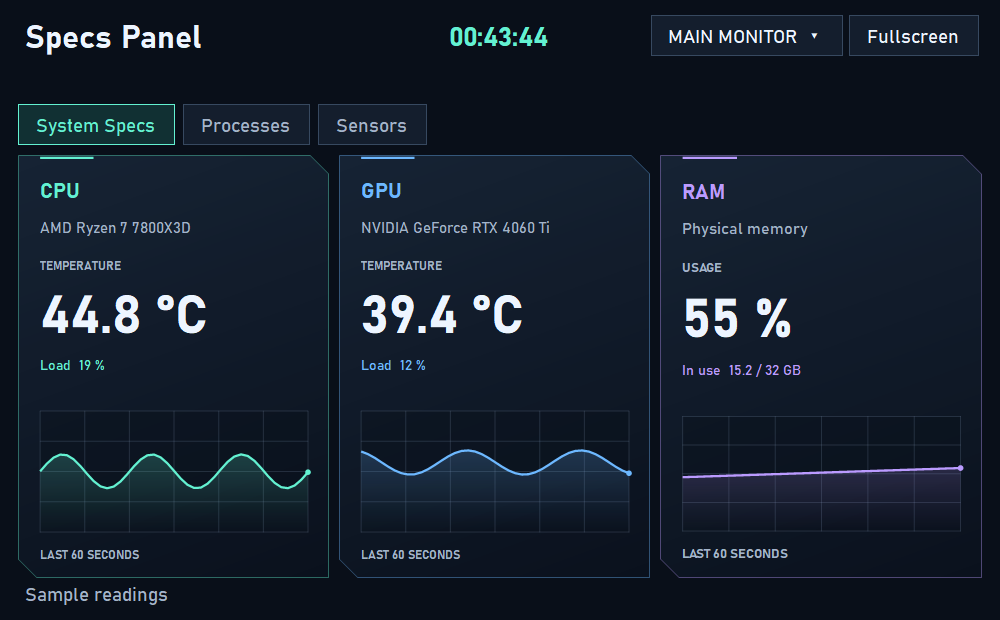
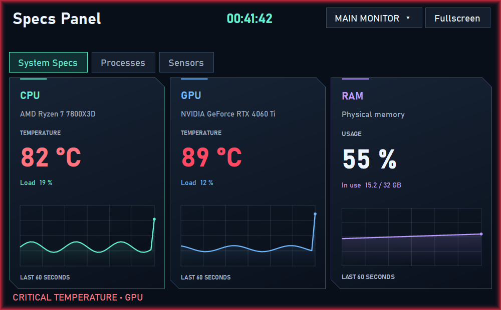

# Specs Panel

Windows dashboard for monitoring your PC on a second display, including any tablet that Windows can use as an extended display.

**[Download Specs Panel for Windows (ZIP)](https://github.com/anejsobann/Specs-Panel/releases/latest/download/SpecsPanel-win-x64.zip)**

*Dashboard preview with sample readings.*

## Download and run

Extract the entire ZIP to a folder and double-click `Start SpecsPanel.cmd`. The Windows ZIP includes the .NET Desktop Runtime and application dependencies. If you downloaded through **Code → Download ZIP**, the launcher downloads and extracts the latest Windows release into the `Windows App` folder on first launch. Approve the Windows UAC prompt if it appears. Specs Panel uses administrator access to read CPU temperature sensors.

Starting with v0.3.2, **Update** appears when a newer release is available. Click it to download only new and changed files, verify the update, and reopen Specs Panel with the same display, tab, and fullscreen mode. Keep using `Start SpecsPanel.cmd` to launch the newest installed version.

1. Connect your tablet as a second display. [spacedesk](https://www.spacedesk.net/download/) offers viewers for Android tablets, iPads, and Windows tablets. You can also use another display solution that adds an extended display to Windows.
2. In Windows display settings, choose **Extend these displays**. Use **Identify** to check the tablet's display number.
3. Select the tablet in Specs Panel and click **Fullscreen**. Press **Esc** or **F11** to return to windowed mode.

**System Specs** shows CPU, GPU, and RAM cards with live readings and charts covering the last 60 seconds. The RAM card shows the module manufacturer and configured speed in MT/s when the firmware reports them.

CPU and GPU temperatures turn red at 80 °C. At 88 °C, Specs Panel shows a critical message and pulses all four edges red on a 3.2-second cycle, including in fullscreen. The alert clears 2 °C below each threshold to avoid switching repeatedly near the boundary.

Click or tap the **Specs Panel** title and choose **Test Temperature Alert** to preview the warning for 15 seconds. The preview is marked **TEST ONLY** and uses a simulated reading without applying any hardware load.

*Example of a critical alert with simulated readings.*

**Processes** lists running processes and their PIDs. Sort by share of total CPU capacity, physical memory (working set), or read and write I/O throughput, which can include network and other devices. CPU and I/O rates need two samples. A dash indicates an unavailable reading.

**Sensors** shows detailed readings for your motherboard, drives, clock speeds, and fans when available.

[LibreHardwareMonitor](https://github.com/LibreHardwareMonitor/LibreHardwareMonitor) uses the [PawnIO](https://github.com/namazso/PawnIO.Setup/releases) driver on supported Ryzen processors. If PawnIO is missing, Specs Panel downloads the installer in the background at startup. If CPU temperature is unavailable, click **Show PawnIO installer** under **System Specs** to locate the downloaded file, then run it to install the driver. If the automatic download fails, the button opens the official releases page.

## Build from source

To publish a new GitHub release, bump `Release-Version.txt` on `main`. GitHub Actions publishes the full ZIP, the file manifest, and incremental ZIPs for earlier releases with manifests.

With the .NET 10 SDK installed, run `./Publish-Local.ps1` in PowerShell and open the `SpecsPanel.exe` at the printed path. The script creates a separate directory for each build under `Specs Panel/bin/Local`. An open instance running with administrator access automatically switches to a newer local build and keeps its selected tab, display, and fullscreen mode.
